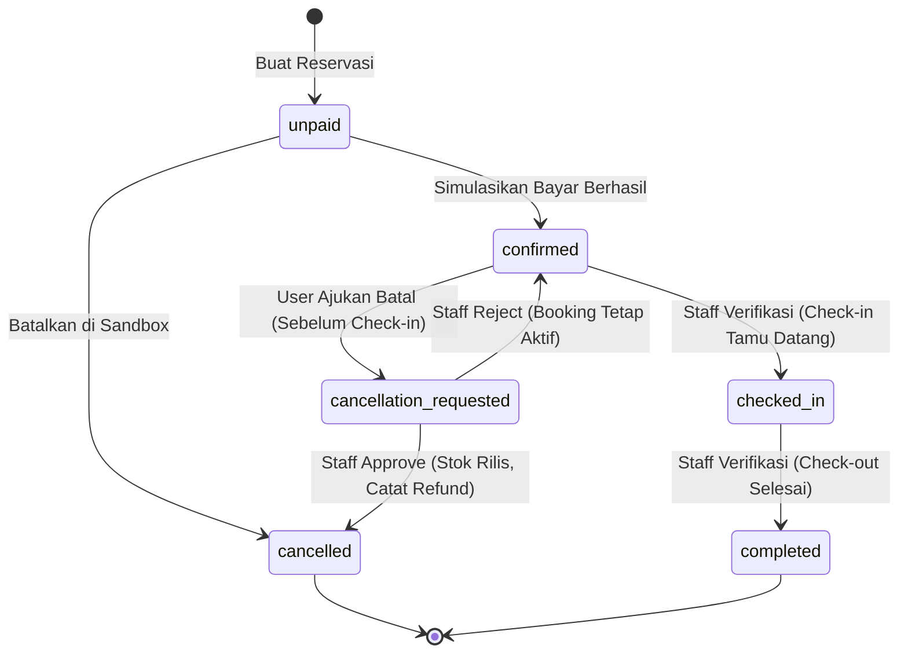

# Project UAS Pemweb: Aplikasi Wisata Glamping (Kelas B)

Aplikasi penyedia wisata Glamping (Glamour Camping) berbasis web fullstack, digunakan oleh tamu/pelanggan untuk melakukan reservasi tempat menginap (tenda/kamar glamping), membaca panduan wisata, serta mengelola pembatalan beransuransi.

---

# Spesifikasi Aplikasi
- **Fokus Domain**: Kelas B — Penyedia Wisata Glamping
- **Framework**: Laravel 12 (PHP 8.3+)
- **Frontend**: Blade + Tailwind CSS v4 (Mobile-First Development, Clean & Minimalist UI)
- **Database**: SQLite / MySQL
- **Tipe**: Web Fullstack Monolith Responsive

---

# Akun Demo Wajib Dosen
- **Admin**: `admin@demo.test` / `Admin#2026`
- **Staff**: `staff@demo.test` / `Staff#2026`
- **User**: `user@demo.test` / `User#2026`

---

# Peran dan Hak Akses (RBAC)

### 1. User / Tamu (Pengunjung)
1. **Beranda & Informasi**:
   - Ringkasan paket glamping unggulan, fasilitas, tata cara reservasi, kontak, dan tautan artikel.
2. **Katalog & Pemesanan Kamar Glamping**:
   - Memilih 1 paket/kamar glamping (misal: *Deluxe Safari Tent*, *Family Glamping Dome*, *Romantic Cabin Forest*).
   - Menentukan tanggal *check-in* (mulai pukul 14.00 WIB) dan tanggal *check-out* (selesai pukul 12.00 WIB). Durasi sewa dihitung per malam.
   - Mengisi data kontak (nama, email, telepon).
   - Opsi tambahan: **Asuransi Pembatalan** (flat Rp 25.000, opsional).
   - Validasi ketersediaan stok unit kamar glamping secara *real-time* per rentang tanggal.
3. **Pembayaran Sandbox (Simulasi Dummy)**:
   - Status awal reservasi: `unpaid`.
   - Menampilkan instruksi pembayaran QRIS dummy sederhana.
   - Tombol pengujian instan: **"Simulasikan Bayar Berhasil"** (langsung pindah ke `confirmed`) dan **"Batalkan Pesanan"** (pindah ke `cancelled`). Tanpa dependensi worker background yang rumit.
4. **Halaman Publik Cek Reservasi & Kartu Digital**:
   - Pengunjung dapat mengecek status booking melalui form publik: **Input Kode Booking + Email/Telepon**.
   - Menampilkan status booking (`confirmed`), kartu digital sewa dengan QR code dummy, dan ringkasan serah terima kamar.
5. **Dashboard Personal User**:
   - Riwayat sewa lengkap dan status reservasi aktif.
   - Form pengajuan pembatalan dengan alasan (hanya sebelum tanggal check-in).
   - Status pengajuan pembatalan (`pending`, `approved`, `rejected`) terpantau jelas di profil.
   - Grafik riwayat sewa/pengeluaran personal.
   - Edit data profil.
6. **Artikel Edukasi Wisata**:
   - Minimal 3 artikel glamping/wisata (contoh: "Tips Glamping Nyaman untuk Pemula", "Checklist Perlengkapan Liburan Alam", "Glamping Minimalis: Menikmati Alam Tanpa Ribet").
7. **Autentikasi**:
   - Registrasi mandiri hanya untuk role User.
   - Login dengan email + password.

### 2. Staff
1. **Dashboard Operasional**:
   - Metrik sewa hari ini, reservasi aktif, permohonan pembatalan yang menunggu persetujuan (*pending approval*), total pendapatan dummy, dan tabel transaksi terkini.
   - Grafik performa operasional: tren penyewaan per periode, rasio pembatalan, dan utilisasi stok kamar glamping.
2. **Panel Verifikasi Serah Terima Kamar (Check-in & Check-out)**:
   - Pencarian kode booking atau scan QR dummy.
   - Checklist sederhana kondisi serah terima kamar glamping (Kamar Bersih, Fasilitas Lengkap, Kunci Diterima).
   - Tombol **Check-in**: status berubah dari `confirmed` $\rightarrow$ `checked_in`.
   - Tombol **Check-out**: status berubah dari `checked_in` $\rightarrow$ `completed`. Stok kamar kembali tersedia.
3. **Manajemen Pembatalan**:
   - Memeriksa permohonan pembatalan dari user beserta alasannya.
   - Tombol **Setujui (Approve)**: status booking menjadi `cancelled`, stok kamar dilepas kembali, dan sistem mencatat nominal refund administratif.
   - Tombol **Tolak (Reject)**: status permohonan menjadi `rejected`, booking tetap berstatus `confirmed`.
4. **CRUD Inventori Kamar Glamping**:
   - Kelola tipe/kamar glamping (nama kamar, kategori, deskripsi, stok total, tarif per malam, dan upload foto).
5. **CRUD Artikel**:
   - Kelola artikel panduan/tips (judul, slug, thumbnail, isi konten).

### 3. Admin
1. **Supervisi Penuh**: Memiliki semua akses operasional Staff.
2. **Manajemen Akun Pengguna**:
   - CRUD akun Admin, Staff, dan User (akun Staff dan Admin hanya dapat dibuat oleh Admin).
3. **Catatan Tindakan Staff (Activity Logs)**:
   - Audit trail otomatis mencatat aksi staff (verifikasi check-in/out, persetujuan/penolakan pembatalan, serta CRUD inventori dan artikel).

---

# Aturan Bisnis & Logika Finansial (Khusus Kelas B)

### 1. Struktur Biaya Reservasi
Total biaya sewa dihitung per malam:
$$\text{Total Bayar} = (\text{Tarif Kamar Glamping} \times \text{Jumlah Malam}) + \text{Premi Asuransi (jika dipilih)}$$

- **Durasi Sewa**: Dihitung per malam (Check-in 14.00 WIB, Check-out 12.00 WIB).
- **Asuransi Pembatalan (Opsional)**: Flat **Rp 25.000** per transaksi booking.

### 2. Kebijakan Asuransi & Refund Pembatalan
Pengajuan pembatalan hanya dapat dilakukan oleh User sebelum tanggal check-in:
- **Jika Menggunakan Asuransi**:
  - Dibatalkan $> 3$ hari sebelum check-in: **Refund 100%** dari total biaya sewa kamar (premi asuransi hangus).
  - Dibatalkan $\le 3$ hari sebelum check-in: **Refund 50%** dari total biaya sewa kamar (premi asuransi hangus).
- **Jika Tanpa Asuransi**:
  - **Refund 0%** (seluruh biaya sewa hangus).
- Catatan: Refund bersifat administratif dummy (cukup pencatatan status dan nominal di sistem tanpa transfer bank nyata).

---

# Siklus Hidup Reservasi (State Machine Ramping)

---

# Skema Database Minimalis (6 Tabel Inti)

Struktur tabel dirancang seringkas mungkin untuk menjaga integritas data dan mencegah potensi bug:

1. **`users`**:
   - `id`, `name`, `email`, `password`, `phone`, `role` (`admin`, `staff`, `user`), timestamps.
2. **`rooms`** (Paket/Tipe Kamar Glamping):
   - `id`, `name`, `category`, `description`, `price_per_night`, `total_stock`, `image_path`, timestamps.
3. **`bookings`**:
   - `id`, `booking_code` (misal: `GLAMP-XXXX`), `user_id`, `room_id`.
   - `guest_name`, `guest_email`, `guest_phone`.
   - `check_in_date`, `check_out_date`, `duration_nights`.
   - `room_price`, `has_insurance` (boolean), `insurance_fee`, `total_amount`.
   - `status` (`unpaid`, `confirmed`, `checked_in`, `completed`, `cancelled`).
   - timestamps.
4. **`cancellation_requests`**:
   - `id`, `booking_id`, `user_id`, `reason`.
   - `refund_percentage`, `refund_amount`.
   - `status` (`pending`, `approved`, `rejected`), `reviewed_by`, `reviewed_at`, timestamps.
5. **`articles`**:
   - `id`, `title`, `slug`, `content`, `thumbnail_path`, `author_id`, timestamps.
6. **`activity_logs`**:
   - `id`, `user_id`, `action`, `description`, `ip_address`, created_at.

---

# Ketentuan Teknis & Agent Rules
1. **Mobile-First Responsive**: Desain tampilan rapi dan responsif diakses dari smartphone maupun desktop.
2. **Minimal Bug & Defensive Coding**:
   - Pengecekan ketersediaan stok menggunakan query rentang tanggal yang bersih (`check_in_date` s/d `check_out_date`).
   - Transaksi database diapit `DB::transaction()` untuk mencegah inkonsistensi status.
3. **Anti-Slop Clean Design**: UI minimalis, kontras warna yang nyaman, tipografi teratur, tanpa animasi berat atau dekorasi berlebihan.
4. **Dokumentasi Kode**: Setiap method controller dan model memiliki PHPDoc singkat yang jelas.
5. **Testing Wajib (Pest)**: Semua alur krusial (booking, kalkulasi asuransi refund, approval pembatalan, check-in/out) diverifikasi melalui Feature Test.
