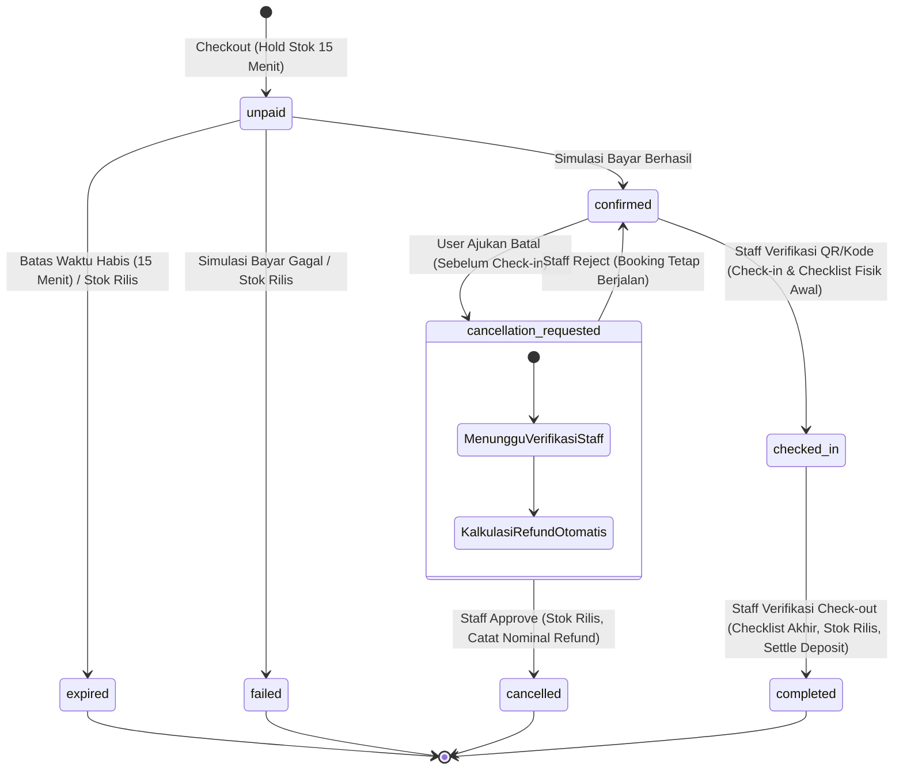

# Project UAS Pemweb: Aplikasi Wisata Glamping (Glamour Camping)

Aplikasi penyedia wisata Glamping (Glamour Camping) berbasis web fullstack, digunakan oleh pelanggan untuk menyewa tempat menginap (tenda/kamar glamping) dan menyewa peralatan camping untuk berkunjung ke tempat wisata.

---

# Spesifikasi Aplikasi
- **Framework**: Laravel 12 (PHP 8.3+)
- **Frontend**: Blade + Tailwind CSS v4 (Mobile-First Development, No-Slop Clean Design)
- **Database**: SQLite / MySQL
- **Tipe**: Web Fullstack (Monolith Responsive)

---

# Akun Demo Pengujian UAS
- **Admin**: `admin@demo.test` / `Admin#2026`
- **Staff**: `staff@demo.test` / `Staff#2026`
- **User**: `user@demo.test` / `User#2026`

---

# Peran dan Hak Akses (RBAC)

### 1. User (Pelanggan)
1. **Beranda & Informasi**: Ringkasan alat camping, tipe kamar/paket glamping, panduan cara reservasi, artikel edukasi, dan kontak.
2. **Katalog & Pemesanan**:
   - Memilih 1 unit kamar glamping utama + opsi item tambahan alat camping harian (*add-on*).
   - Menentukan tanggal mulai (*check-in* jam 14.00) dan tanggal selesai (*check-out* jam 12.00). Durasi dihitung per malam.
   - Pilihan asuransi pembatalan (opsional, flat Rp 25.000).
   - Deposit jaminan kerusakan flat Rp 50.000 (dikembalikan saat check-out).
   - Validasi ketersediaan stok kamar dan alat secara *real-time* per rentang tanggal.
3. **Pembayaran Sandbox / Dummy**:
   - Status `unpaid` mengunci kuota stok sementara (*temporary hold*) selama 15 menit dengan simulasi QRIS dinamis dummy.
   - Tersedia tombol simulasi cepat: **"Simulasikan Bayar Berhasil"** (pindah ke `confirmed`) dan **"Simulasikan Bayar Gagal"** (stok langsung rilis kembali).
4. **Kartu Digital & QR Serah Terima**:
   - Akses kartu digital sewa (wajib login) berisi kode booking unik alfanumerik, QR code dummy, detail kamar, dan daftar alat camping yang disewa saat itu.
   - Kode booking dapat diketik manual oleh Staff jika pemindaian QR mengalami kendala.
   - Checklist dinamis serah terima kondisi fisik unit/alat.
5. **Artikel**: Membaca minimal 3 artikel wisata/camping (contoh: "Tips Memilih Tenda untuk Pemula", "Checklist Alat Camping", "Glamping Minimalis").
6. **Dashboard Personal**:
   - Menampilkan ringkasan akun: total transaksi, status booking aktif, dan daftar alat yang sedang disewa.
   - Riwayat penyewaan lengkap, status pembayaran, dan riwayat pengajuan pembatalan.
   - Edit profil / data pribadi.
7. **Pengajuan Pembatalan**:
   - Form pengajuan pembatalan reservasi dengan alasan pembatalan.
   - Hanya dapat diajukan sebelum tanggal mulai sewa (sebelum proses check-in).
   - Sistem menampilkan estimasi refund otomatis sesuai kepemilikan asuransi.
   - Status pengajuan terpantau di profil (`pending`, `approved`, `rejected`).
8. **Autentikasi**: Registrasi mandiri hanya tersedia untuk role User. Login email + password.

### 2. Staff
1. **Dashboard Operasional**:
   - Metrik sewa hari ini, check-in/out hari ini, daftar pembatalan menunggu persetujuan (*pending approval*), total pendapatan dummy, dan tabel transaksi terkini.
   - Grafik performa bisnis: grafik tren penyewaan per periode, persentase pembatalan, dan tingkat utilisasi stok alat/kamar.
2. **Panel Verifikasi & Serah Terima (Check-in & Check-out)**:
   - Pencarian/pemindaian kartu QR atau input manual kode booking.
   - Verifikasi checklist dinamis fisik unit kamar & alat camping (kondisi: Baik, Rusak, Hilang).
   - Proses Check-in: mengubah status dari `confirmed` menjadi `checked_in`.
   - Proses Check-out:
     - Jika kondisi baik: status menjadi `completed`, deposit Rp 50.000 dicatat dikembalikan penuh (*refunded*).
     - Jika ada barang rusak/hilang: input nominal potongan deposit (Rp 0 - Rp 50.000) beserta catatan administrasi kerusakan saat mengubah status menjadi `completed`.
     - Stok unit kamar dan alat otomatis dikembalikan ke inventori.
3. **Manajemen Pembatalan**:
   - Memeriksa alasan pembatalan dan kalkulasi refund sistem.
   - Tombol **Terima (Approve)**: status booking menjadi `cancelled`, status permintaan `approved`, stok inventori dilepas kembali, dan catatan refund dicatat.
   - Tombol **Tolak (Reject)**: status permintaan `rejected`, status booking kembali ke `confirmed`.
4. **CRUD Inventori**: Kelola unit kamar glamping dan alat camping (kategori, nama, deskripsi, stok total, tarif harian/per malam, dan upload foto lokal).
5. **CRUD Artikel**: Kelola artikel edukasi/tips (judul, slug, thumbnail, isi/konten artikel).

### 3. Admin
1. **Supervisi Penuh**: Memiliki seluruh hak akses operasional Staff.
2. **Manajemen Akun**: CRUD akun pengguna untuk role Admin, Staff, dan User. Pembuatan akun Staff dan Admin hanya dapat dilakukan melalui panel Admin ini.
3. **Log Tindakan Staff (Audit Trail)**:
   - Rekam riwayat aksi operasional Staff: verifikasi check-in/out, persetujuan/penolakan pembatalan, penyesuaian deposit/denda, mutasi stok, serta CRUD inventori dan artikel.

---

# Aturan Bisnis & Logika Finansial

### 1. Struktur Biaya Reservasi
Total tagihan pada saat reservasi dihitung dengan formula:
$$\text{Total Bayar} = (\text{Tarif Kamar} \times \text{Malam}) + \sum (\text{Tarif Alat} \times \text{Jumlah} \times \text{Malam}) + \text{Premi Asuransi} + \text{Deposit Jaminan}$$

- **Durasi Sewa**: Dihitung per malam (Check-in pukul 14.00 WIB, Check-out pukul 12.00 WIB).
- **Asuransi Pembatalan**: Opsi tambahan flat **Rp 25.000** per transaksi booking.
- **Deposit Jaminan**: Flat **Rp 50.000** per transaksi booking (dibayar di muka, dikembalikan saat check-out bila kondisi unit/alat baik).

### 2. Kebijakan Refund & Pembatalan
Pengajuan pembatalan hanya dapat dilakukan oleh User sebelum tanggal sewa dimulai:
- **Jika Memilih Asuransi**:
  - Dibatalkan $> 3$ hari sebelum tanggal check-in: **Refund 100%** dari total biaya sewa (deposit kembali, premi asuransi hangus).
  - Dibatalkan $\le 3$ hari sebelum tanggal check-in: **Refund 50%** dari total biaya sewa (deposit kembali, premi asuransi hangus).
- **Jika Tanpa Asuransi**:
  - **Refund 0%** (seluruh uang sewa hangus, deposit Rp 50.000 dikembalikan).
- Pembatalan diproses secara administratif (pembayaran dummy; tidak perlu transfer bank nyata, cukup pencatatan nominal refund di sistem).

---

# Siklus Hidup Transaksi (State Machine)

> **Visual Canvas**: Diagram interaktif tersedia pada file [`docs/state_machine.canvas`](docs/state_machine.canvas).

---

# Skema Database Utama

1. **`users`**: `id`, `name`, `email`, `password`, `phone`, `role` (`admin`, `staff`, `user`).
2. **`products`** (Kamar Glamping & Alat Camping): `id`, `name`, `type` (`room`, `equipment`), `category`, `description`, `price_per_night`, `total_stock`, `image_path`.
3. **`bookings`**:
   - `id`, `booking_code` (unik, misal `GLAMP-20261028-XXXX`), `user_id`, `check_in_date`, `check_out_date`.
   - `insurance_selected` (boolean), `insurance_fee`, `deposit_amount`, `deposit_deduction`, `deposit_refunded`.
   - `subtotal_room`, `subtotal_equipment`, `total_amount`.
   - `status` (`unpaid`, `confirmed`, `checked_in`, `completed`, `cancelled`, `expired`).
   - `payment_simulated_at`, `expires_at`.
4. **`booking_items`**: `id`, `booking_id`, `product_id`, `quantity`, `price_per_unit`, `subtotal`.
5. **`cancellation_requests`**: `id`, `booking_id`, `user_id`, `reason`, `refund_percentage`, `refund_amount`, `status` (`pending`, `approved`, `rejected`), `reviewed_by` (staff_id), `reviewed_at`, `notes`.
6. **`checklists`**: `id`, `booking_id`, `type` (`check_in`, `check_out`), `item_condition` (JSON kondisi tiap barang: baik/rusak/hilang), `damage_notes`, `deduction_amount`, `staff_id`.
7. **`articles`**: `id`, `title`, `slug`, `content`, `thumbnail_path`, `author_id`.
8. **`activity_logs`**: `id`, `user_id` (staff/admin), `action`, `description`, `ip_address`, `created_at`.

---

# Media & Penyimpanan
- Upload gambar artikel dan inventori disimpan pada storage lokal Laravel (`storage/app/public` via `php artisan storage:link`).
- Sistem wajib menyediakan *fallback placeholder image* jika gambar tidak diunggah.

---

# Ketentuan Teknis & Agent Rules
1. **Codebase Memory**: Gunakan codebase memory MCP untuk navigasi dan penelusuran arsitektur kode.
2. **Mobile First**: Seluruh layout dan komponen frontend dirancang responsif dengan pendekatan mobile-first.
3. **Anti-Slop UI**: Desain antarmuka bersih, tipografi teratur, kontras jelas, tanpa elemen dekoratif berlebihan dan gunakan skill relevan untuk mengurangi slop.
4. **Dokumentasi Kode**: Setiap fungsi dan method Controller/Service wajib memiliki PHPDoc yang jelas.
5. **Testing & Seeder**:
   - Seeder mencakup 3 akun demo default (`admin@demo.test`, `staff@demo.test`, `user@demo.test`), inventori kamar & alat, minimal 3 artikel wajib, dan contoh transaksi aktif untuk pengujian dashboard dosen/evaluator.
   - Dilarang membuat file verifikasi manual / script sekali pakai jika dapat dibuktikan via feature test (Pest).
6. **Delete first never duplicate**
   - Make sure code never repeat at different place.
   - Never write complicated code. 
   - When component is used in different place make component first then use it in many place